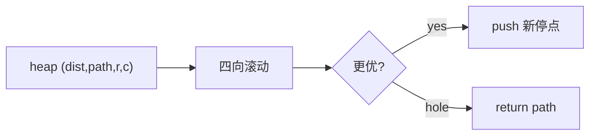

# LC 499. The Maze III

> Hard · [LeetCode](https://leetcode.com/problems/the-maze-iii/) · Tags: DFS, BFS, Graph, Heap

## 题意

迷宫中球沿四向滚到撞墙/边界才停；若滚过洞则掉入。求从球到洞的最短路径指令串（`d/l/r/u`）；距离相同取字典序最小；不可达返回 `"impossible"`。

## 最优思路

Dijkstra：状态为停靠点 `(r,c)`，优先队列按 `(距离, 路径字典序)`。每次向四向滚动直至墙或洞，松弛更优距离/路径。

## 图解

```text
ball → 滚 l/u/... → hole
优先: 距离短 > 同距字典序小
dirs 按 d,l,r,u 便于自然序
```



## 复杂度

| 项 | 值 |
|----|----|
| 时间 | \(O(mn\log(mn)\cdot\max(m,n))\) |
| 空间 | \(O(mn)\) |

## 代码

见 `499.the-maze-iii.py`。
