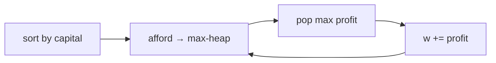

# LC 502. IPO

> Hard · [LeetCode](https://leetcode.com/problems/ipo/) · Tags: Array, Greedy, Sorting, Heap

## 题意

最多做 `k` 个项目；每个项目需资本 ≥ `capital[i]`，完成后利润 `profits[i]` 加入总资本。求最终最大资本。

## 最优思路

按资本升序排序；当前资本能启动的项目利润进大根堆，每次选堆顶利润最大者，重复最多 `k` 次。

## 图解

```text
w=0, k=2
projects: (0,1)(1,2)(1,3)
可做 (0,1) → w=1 → 可选 2 或 3 → 取 3 → w=4
```



## 复杂度

| 项 | 值 |
|----|----|
| 时间 | \(O(n\log n)\) |
| 空间 | \(O(n)\) |

## 代码

见 `502.ipo.py`。
