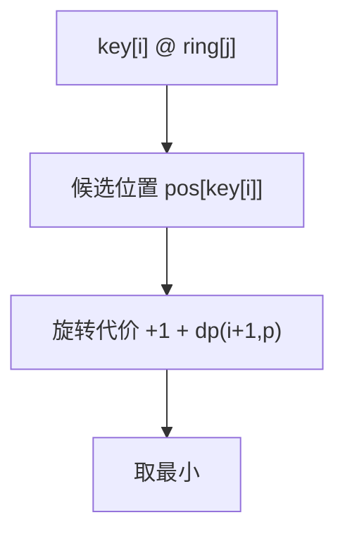

# LC 514. Freedom Trail

> Hard · [LeetCode](https://leetcode.com/problems/freedom-trail/) · Tags: String, DP, DFS, Breadth-First Search

## 题意

圆环 `ring` 可旋转，顶部对准字符后按一下拼出 `key`。求最少步数（旋转 + 按键）。

## 最优思路

预处理每个字符出现位置。`dp(i, j)`：拼 `key[i:]` 且圆环当前位置为 `j` 的最少步。转移到 `key[i]` 的每个位置 `p`，代价 `min(|p-j|, n-|p-j|)+1`。

## 图解

```text
ring = godding  (圆形)
key  = gd
g→位置0, 再转 d→位置2 或 3，取较短 + 两次 spell
答案 4
```



## 复杂度

| 项 | 值 |
|----|----|
| 时间 | \(O(|key|\cdot|ring|^2)\) |
| 空间 | \(O(|key|\cdot|ring|)\) |

## 代码

见 `514.freedom-trail.py`。
