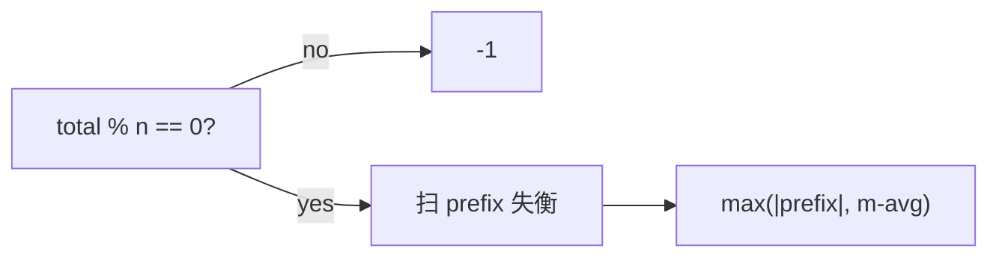

# LC 517. Super Washing Machines

> Hard · [LeetCode](https://leetcode.com/problems/super-washing-machines/) · Tags: Array, Greedy

## 题意

每台洗衣机可同时向左右邻居各给 1 件衣服。求使所有机器衣服数相等的最少操作次数；不可能则 -1。

## 最优思路

总和不能被 `n` 整除则 -1。均值 `avg` 后，前缀失衡 `prefix = Σ(machines[i]-avg)` 表示需净流过的衣服量；答案为 `max(|prefix|, machines[i]-avg)` 的最大值（单机给出量与跨段流量的瓶颈）。

## 图解

```text
[1,0,5] avg=2
diffs: -1,-2,+3
prefix: -1,-3,0
max(|prefix|, diff) → 3
```



## 复杂度

| 项 | 值 |
|----|----|
| 时间 | \(O(n)\) |
| 空间 | \(O(1)\) |

## 代码

见 `517.super-washing-machines.py`。
