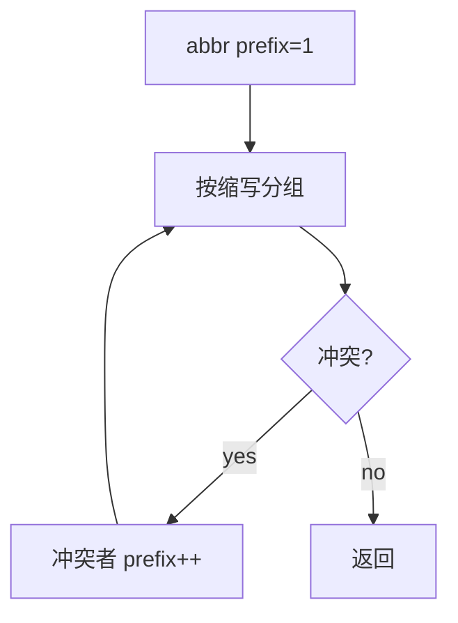

# LC 527. Word Abbreviation

> Hard · [LeetCode](https://leetcode.com/problems/word-abbreviation/) · Tags: Array, String, Greedy, Trie, Sorting

## 题意

把词缩写为 `首字母 + 中间长度 + 尾字母`（更短才缩写）。若冲突则加长前缀直到唯一，返回与输入同序的缩写列表。

## 最优思路

初始前缀长度均为 1；按当前缩写分组，冲突组内每人前缀 +1 并重算，直到无冲突。过短词（缩写不更短）保持原词。

## 图解

```text
internal / interval  都曾是 i6l
→ inte3l / inte3l → … → internal / interval
intension / intrusion → inte4n / intr4n
```



## 复杂度

| 项 | 值 |
|----|----|
| 时间 | \(O(n\cdot L^2)\) 最坏 |
| 空间 | \(O(n\cdot L)\) |

## 代码

见 `527.word-abbreviation.py`。
