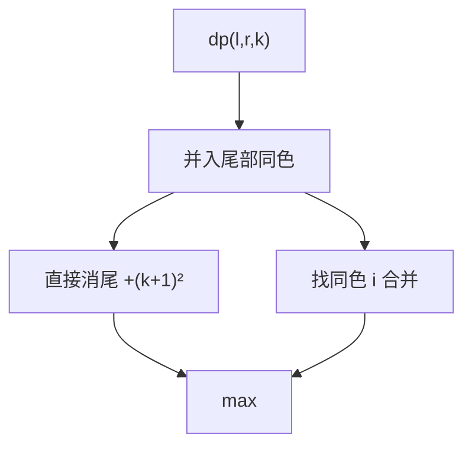

# LC 546. Remove Boxes

> Hard · [LeetCode](https://leetcode.com/problems/remove-boxes/) · Tags: Array, Memoization, DP

## 题意

若干盒子颜色序列，每次消去一段连续同色得 `len²` 分，消去后左右合并。求最高总分。

## 最优思路

`dp(l,r,k)`：消除 `boxes[l..r]`，且 `r` 右侧已有 `k` 个与 `boxes[r]` 同色待一起消。先把尾部同色并入 `k`，两种策略：

1. 直接消掉尾部组：`dp(l,r-1,0)+(k+1)²`
2. 枚举 `i∈[l,r)` 且 `boxes[i]==boxes[r]`，先消中间再与 `i` 合并：`dp(l,i,k+1)+dp(i+1,r-1,0)`

## 图解

```text
[1,3,2,2,2,3,4,3,1]
先消三个 2 → 9，得 [1,3,3,4,3,1]
再凑 3… → 总分 23
```



## 复杂度

| 项 | 值 |
|----|----|
| 时间 | \(O(n^4)\) |
| 空间 | \(O(n^3)\) |

## 代码

见 `546.remove-boxes.py`。
