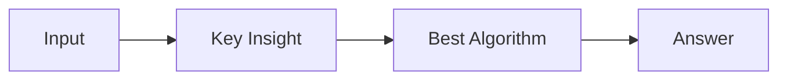

# LC 631. Design Excel Sum Formula

> Hard · [LeetCode](https://leetcode.com/problems/design-excel-sum-formula/) · Tags: Array, Hash Table, String, Graph Theory, Design, Topological Sort, Matrix

## 题意

（待补：一句话题意）

## 最优思路

（待补：最优解核心 intuition）

## 图解

## 复杂度

| 项 | 值 |
|----|----|
| 时间 | TBD |
| 空间 | TBD |

## 代码

见同目录 `631.design-excel-sum-formula.py`。

## 参考

- https://leetcode.com/problems/design-excel-sum-formula/
