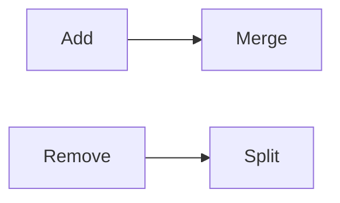

# LC 715. Range Module

> Hard · [LeetCode](https://leetcode.com/problems/range-module/)

## 题意

维护半开区间：add/query/remove。

## 最优思路

有序区间列表合并/切割。

## 图解

## 复杂度

| 项 | 值 |
|----|----|
| 操作 | \(O(n)\) |
| 空间 | \(O(n)\) |
