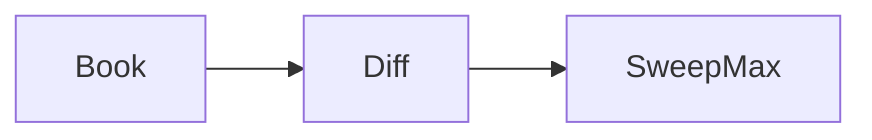

# LC 732. My Calendar III

> Hard · [LeetCode](https://leetcode.com/problems/my-calendar-iii/)

## 题意

预约区间，返回当前最大重叠（k-booking）。

## 最优思路

差分数组：start+1 end-1；扫描求前缀最大。

## 图解

## 复杂度

| 项 | 值 |
|----|----|
| book | \(O(n\log n)\) |
| 空间 | \(O(n)\) |
