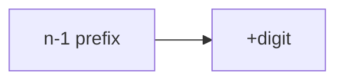

# LC 753. Cracking the Safe

> Hard · [LeetCode](https://leetcode.com/problems/cracking-the-safe/)

## 题意

最短密码串覆盖所有 n 位 k 进制组合。

## 最优思路

de Bruijn：Hierholzer 欧拉路径。

## 图解

## 复杂度

| 项 | 值 |
|----|----|
| 时间 | \(O(k^n)\) |
| 空间 | \(O(k^n)\) |
