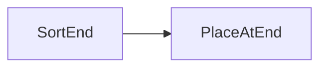

# LC 757. Set Intersection Size At Least Two

> Hard · [LeetCode](https://leetcode.com/problems/set-intersection-size-at-least-two/)

## 题意

最小集合使每个区间至少含 2 个元素。

## 最优思路

按右端排序；贪心在右端放点，维护最近两点。

## 图解

## 复杂度

| 项 | 值 |
|----|----|
| 时间 | \(O(n\log n)\) |
| 空间 | \(O(1)\) |
