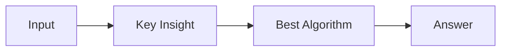

# LC 805. Split Array With Same Average

> Hard · [LeetCode](https://leetcode.com/problems/split-array-with-same-average/) · Tags: Array, Hash Table, Math, Dynamic Programming, Bit Manipulation, Meet in the Middle, Bitmask

## 题意

（待补：一句话题意）

## 最优思路

（待补：最优解核心 intuition）

## 图解

## 复杂度

| 项 | 值 |
|----|----|
| 时间 | TBD |
| 空间 | TBD |

## 代码

见同目录 `805.split-array-with-same-average.py`。

## 参考

- https://leetcode.com/problems/split-array-with-same-average/
