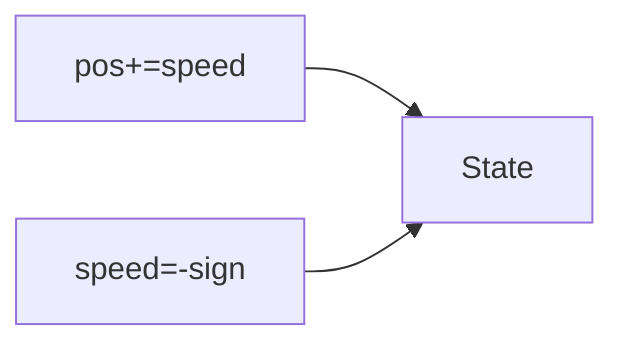

# LC 818. Race Car

> Hard · [LeetCode](https://leetcode.com/problems/race-car/)

## 题意

指令 A/R 最少步到 target。

## 最优思路

BFS 状态 `(position, speed)`。

## 图解

## 复杂度

| 项 | 值 |
|----|----|
| 时间 | 与 target 相关 |
| 空间 | 同左 |
