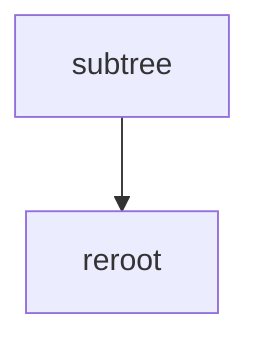

# LC 834. Sum of Distances in Tree

> Hard · [LeetCode](https://leetcode.com/problems/sum-of-distances-in-tree/)

## 题意

树上每个节点到其余节点距离和。

## 最优思路

换根 DP：先算根答案与子树大小，再 `dp[v]=dp[u]-size[v]+(n-size[v])`。

## 图解

## 复杂度

| 项 | 值 |
|----|----|
| 时间 | \(O(n)\) |
| 空间 | \(O(n)\) |
