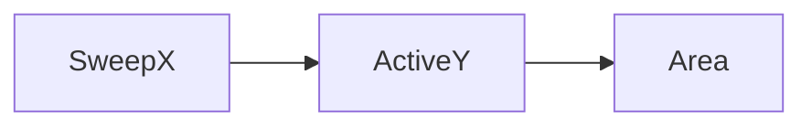

# LC 850. Rectangle Area II

> Hard · [LeetCode](https://leetcode.com/problems/rectangle-area-ii/)

## 题意

矩形并集面积（模 1e9+7）。

## 最优思路

x 扫描线 + 活跃 y 区间合并求高。

## 图解

## 复杂度

| 项 | 值 |
|----|----|
| 时间 | \(O(n^2)\) |
| 空间 | \(O(n)\) |
