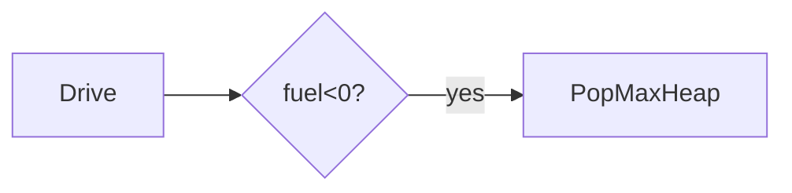

# LC 871. Minimum Number of Refueling Stops

> Hard · [LeetCode](https://leetcode.com/problems/minimum-number-of-refueling-stops/)

## 题意

最少加油次数到达 target。

## 最优思路

路过加油站燃料入大根堆；不够时贪心取最大堆加油。

## 图解

## 复杂度

| 项 | 值 |
|----|----|
| 时间 | \(O(n\log n)\) |
| 空间 | \(O(n)\) |
