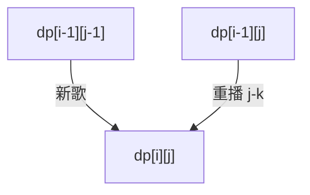

# LC 920. Number of Music Playlists

> Hard · [LeetCode](https://leetcode.com/problems/number-of-music-playlists/) · Tags: Math, Dynamic Programming, Combinatorics

## 题意

有 `n` 首歌，做长度为 `goal` 的播放列表：每首歌至少出现一次，且同一首歌再次播放时中间至少隔 `k` 首不同歌。求方案数。

## 最优思路

\(dp[i][j]\)：长度 i、恰用 j 首不同歌。转移：加新歌 ×(n-j+1)，或重播旧歌 ×(j-k)（当 j>k）。

## 图解

## 复杂度

| 项 | 值 |
|----|----|
| 时间 | \(O(n \\cdot goal)\) |
| 空间 | \(O(n \\cdot goal)\) |

## 代码

见 `920.number-of-music-playlists.py`。

