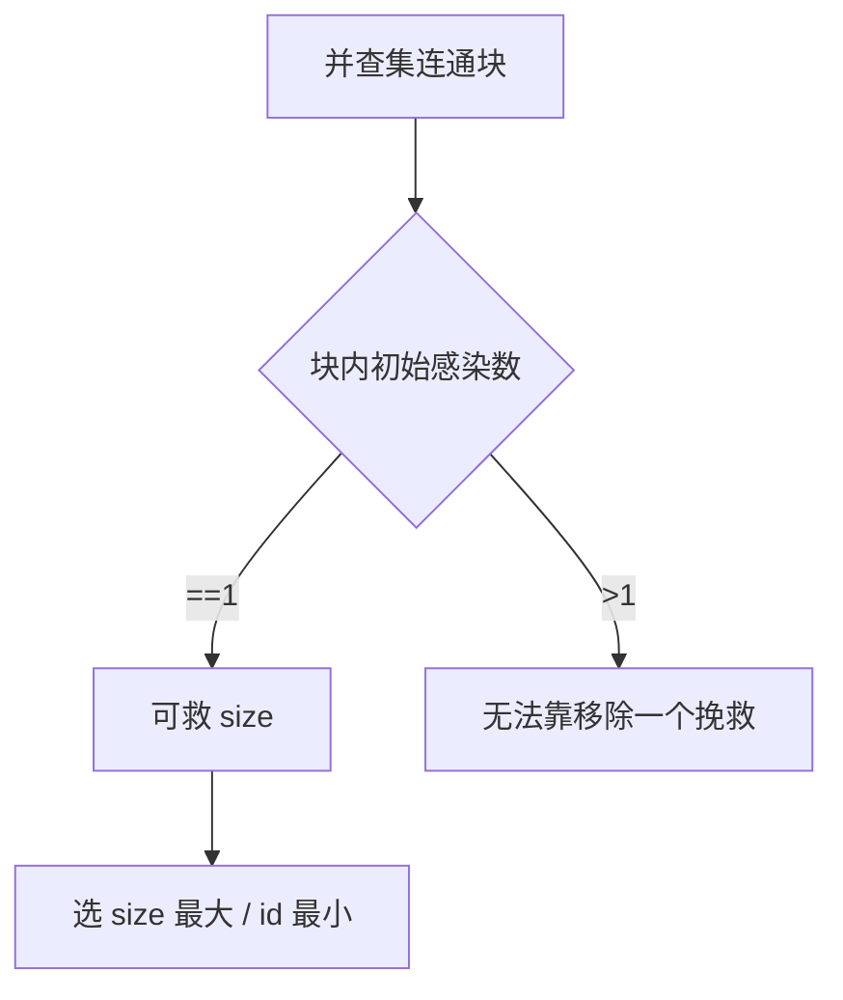

# LC 924. Minimize Malware Spread

> Hard · [LeetCode](https://leetcode.com/problems/minimize-malware-spread/) · Tags: Array, Hash Table, Depth-First Search, Breadth-First Search, Union-Find, Graph Theory

## 题意

无向图 + 初始感染集合；移除一个初始节点后，剩余感染沿边传播。选移除后最终感染最少的节点（并列取编号最小）。

## 最优思路

并查集求连通块。仅当某连通块内恰有 1 个初始感染点时，移除它可救整块；选救点数最多者，否则取最小编号。

## 图解

## 复杂度

| 项 | 值 |
|----|----|
| 时间 | \(O(n^2)\) |
| 空间 | \(O(n)\) |

## 代码

见 `924.minimize-malware-spread.py`。

