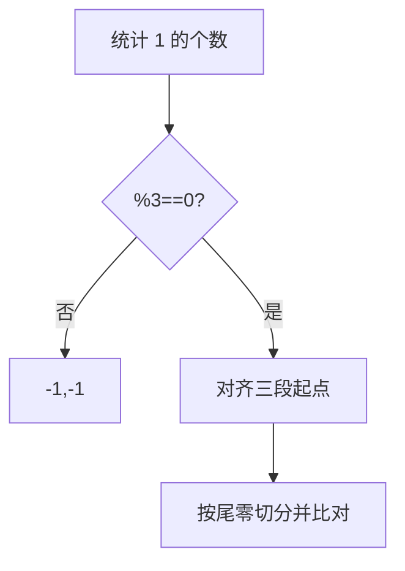

# LC 927. Three Equal Parts

> Hard · [LeetCode](https://leetcode.com/problems/three-equal-parts/) · Tags: Array, Math

## 题意

把 0/1 数组切成三段，使三段表示的二进制数值相等；返回切点 `[i,j]`（`arr[0..i]`、`arr[i+1..j-1]`、`arr[j..]`），无解返回 `[-1,-1]`。

## 最优思路

1 的个数必须被 3 整除。按三分之一的 1 对齐三段的「有效二进制」起点，末尾零个数由最后一段决定，再线性比对三段是否相同。

## 图解

## 复杂度

| 项 | 值 |
|----|----|
| 时间 | \(O(n)\) |
| 空间 | \(O(n)\) |

## 代码

见 `927.three-equal-parts.py`。

