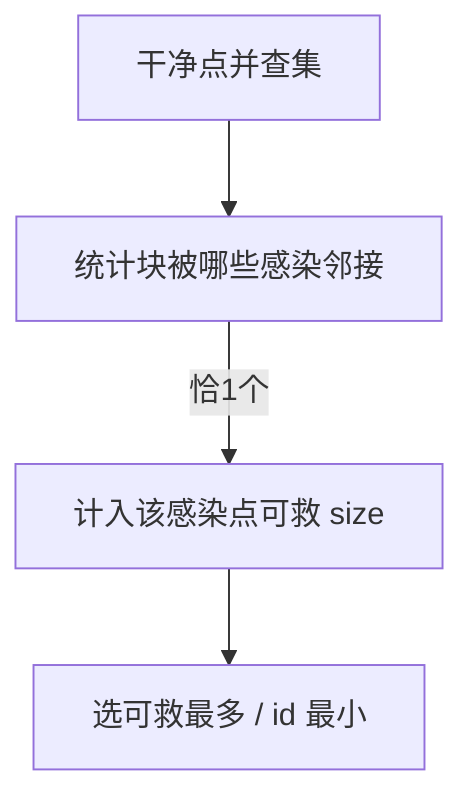

# LC 928. Minimize Malware Spread II

> Hard · [LeetCode](https://leetcode.com/problems/minimize-malware-spread-ii/) · Tags: Array, Hash Table, Depth-First Search, Breadth-First Search, Union-Find, Graph Theory

## 题意

与 924 类似，但移除的感染节点在传播开始前删除（边断开）。选移除后最终感染最少者。

## 最优思路

先对非感染节点并查集。每个干净连通块若只被恰好一个初始感染点邻接，则移除该点可救整块。累计可救点数最大、编号最小。

## 图解

## 复杂度

| 项 | 值 |
|----|----|
| 时间 | \(O(n^2)\) |
| 空间 | \(O(n)\) |

## 代码

见 `928.minimize-malware-spread-ii.py`。
