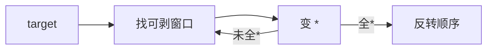

# LC 936. Stamping The Sequence

> Hard · [LeetCode](https://leetcode.com/problems/stamping-the-sequence/) · Tags: String, Stack, Greedy, Queue

## 题意

用印章 `stamp` 盖到初始全 `?` 的串上（可重叠覆盖），目标得到 `target`。返回一组盖印起始下标（次数 ≤ 10·n），无解返回 `[]`。

## 最优思路

逆向贪心：从 `target` 反复找仍能匹配 `stamp`（`*` 为通配）的窗口，剥成 `*`，直到全 `*`；再把操作序列反转即为正向盖印顺序。

## 图解

## 复杂度

| 项 | 值 |
|----|----|
| 时间 | \(O(n^2 \\cdot m)\) |
| 空间 | \(O(n)\) |

## 代码

见 `936.stamping-the-sequence.py`。
