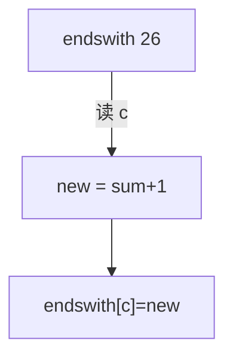

# LC 940. Distinct Subsequences II

> Hard · [LeetCode](https://leetcode.com/problems/distinct-subsequences-ii/) · Tags: String, Dynamic Programming

## 题意

求字符串不同非空子序列个数（模 \(10^9+7\)）。

## 最优思路

维护以每个字母结尾的不同子序列数。读入 `c` 时，新的以 `c` 结尾集合 =（全部旧子序列 + 空）拼接 `c`，覆盖旧的以 `c` 结尾（去重）。

## 图解

## 复杂度

| 项 | 值 |
|----|----|
| 时间 | \(O(n)\) |
| 空间 | \(O(1)\) |

## 代码

见 `940.distinct-subsequences-ii.py`。
