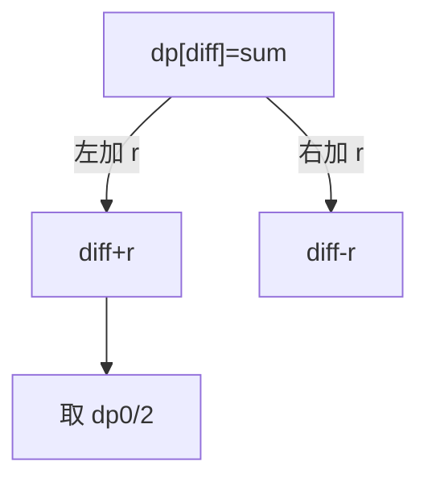

# LC 956. Tallest Billboard

> Hard · [LeetCode](https://leetcode.com/problems/tallest-billboard/) · Tags: Array, Dynamic Programming, Meet in the Middle, Knapsack Problem, 0-1 Knapsack

## 题意

钢条分到左右两根立柱（可不用），使两边高度相等且尽可能高；返回该高度。

## 最优思路

差分背包：`dp[diff]` 为达成左右差 `diff` 时已用钢条总和最大值；差为 0 时高度 = 总和/2。

## 图解

## 复杂度

| 项 | 值 |
|----|----|
| 时间 | \(O(n \\cdot \\sum rods)\) |
| 空间 | \(O(\\sum rods)\) |

## 代码

见 `956.tallest-billboard.py`。
