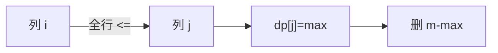

# LC 960. Delete Columns to Make Sorted III

> Hard · [LeetCode](https://leetcode.com/problems/delete-columns-to-make-sorted-iii/) · Tags: Array, String, Dynamic Programming

## 题意

删尽量少的列，使剩下每一行读出来都是非降序。

## 最优思路

列上做 LIS：`dp[j]` 为以列 j 结尾的最长可保留列序列；两列可比当且仅当所有行该列字符非降。答案 = m - max(dp)。

## 图解

## 复杂度

| 项 | 值 |
|----|----|
| 时间 | \(O(n m^2)\) |
| 空间 | \(O(m)\) |

## 代码

见 `960.delete-columns-to-make-sorted-iii.py`。
