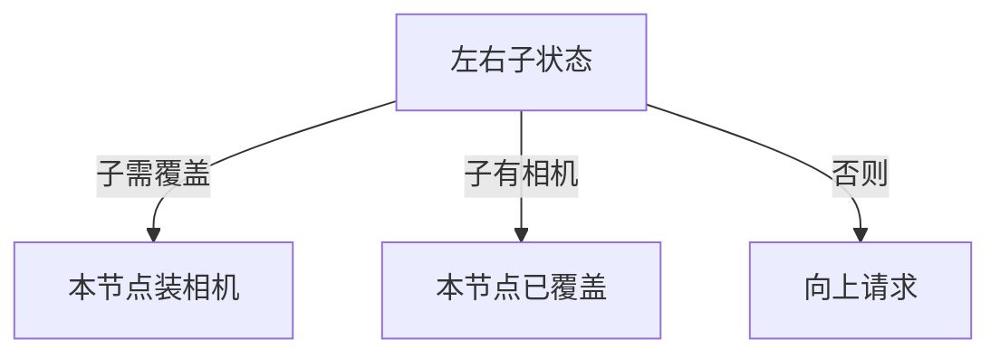

# LC 968. Binary Tree Cameras

> Hard · [LeetCode](https://leetcode.com/problems/binary-tree-cameras/) · Tags: Dynamic Programming, Tree, Depth-First Search, Binary Tree, DP on Trees

## 题意

二叉树每个节点可装摄像头，覆盖自己与相邻节点；求覆盖整棵树的最少摄像头数。

## 最优思路

后序贪心三态：子需覆盖则本节点装相机；子有相机则本节点已覆盖；否则向上请求覆盖。根若仍需覆盖则 +1。

## 图解

## 复杂度

| 项 | 值 |
|----|----|
| 时间 | \(O(n)\) |
| 空间 | \(O(h)\) |

## 代码

见 `968.binary-tree-cameras.py`。
