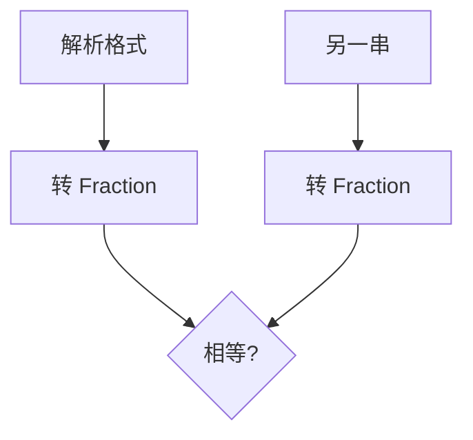

# LC 972. Equal Rational Numbers

> Hard · [LeetCode](https://leetcode.com/problems/equal-rational-numbers/) · Tags: Math, String

## 题意

比较两个有理数字符串是否相等；格式可为整数、小数、循环节如 `0.(52)`。

## 最优思路

解析为 `Fraction`：整数部分 + 非循环小数 + 循环节 \(rep/(10^{|b|}(10^{|c|}-1))\)，再比较。

## 图解

## 复杂度

| 项 | 值 |
|----|----|
| 时间 | \(O(L)\) |
| 空间 | \(O(1)\) |

## 代码

见 `972.equal-rational-numbers.py`。
