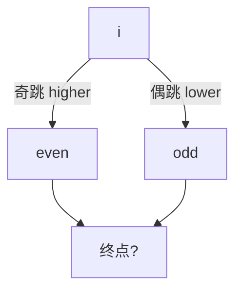

# LC 975. Odd Even Jump

> Hard · [LeetCode](https://leetcode.com/problems/odd-even-jump/) · Tags: Array, Dynamic Programming, Stack, Sorting, Monotonic Stack, Ordered Set

## 题意

奇数次跳跳到右侧 ≥ 当前值的最小者（并列取最左）；偶数次跳到 ≤ 的最大者。问有多少起点能经跳跃到达末尾。

## 最优思路

从右往左 DP：`odd[i]`/`even[i]` 表示下次奇/偶跳能否到达。用排序+单调栈预处理 next higher/lower。

## 图解

## 复杂度

| 项 | 值 |
|----|----|
| 时间 | \(O(n \\log n)\) |
| 空间 | \(O(n)\) |

## 代码

见 `975.odd-even-jump.py`。
