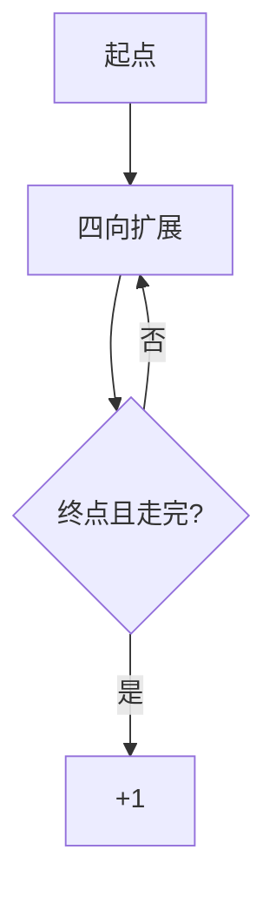

# LC 980. Unique Paths III

> Hard · [LeetCode](https://leetcode.com/problems/unique-paths-iii/) · Tags: Array, Backtracking, Bit Manipulation, Matrix, Hamiltonian Path

## 题意

网格中从起点走到终点，经过每个非障碍空格恰好一次，求路径数。

## 最优思路

回溯：记录剩余需走格子数，走到终点且剩余为 1 则计数；访问时标记障碍再回溯恢复。

## 图解

## 复杂度

| 项 | 值 |
|----|----|
| 时间 | \(O(3^{mn})\) |
| 空间 | \(O(mn)\) |

## 代码

见 `980.unique-paths-iii.py`。
