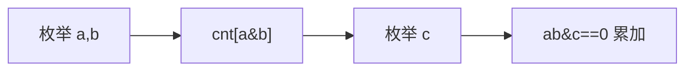

# LC 982. Triples with Bitwise AND Equal To Zero

> Hard · [LeetCode](https://leetcode.com/problems/triples-with-bitwise-and-equal-to-zero/) · Tags: Array, Hash Table, Bit Manipulation

## 题意

数组中取三元组（可重复下标）满足 `(a & b & c) == 0` 的个数。

## 最优思路

先枚举所有 `(a&b)` 频数，再对每个 `c` 累加与之 AND 为 0 的频数。

## 图解

## 复杂度

| 项 | 值 |
|----|----|
| 时间 | \(O(n^2 + n \\cdot U)\) |
| 空间 | \(O(U)\) |

## 代码

见 `982.triples-with-bitwise-and-equal-to-zero.py`。
