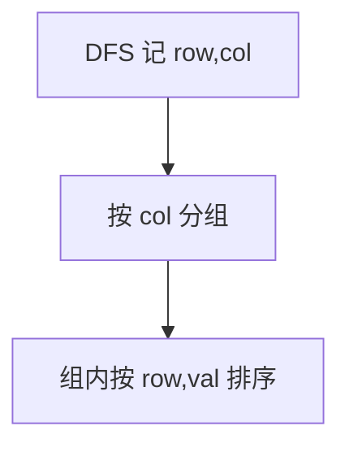

# LC 987. Vertical Order Traversal of a Binary Tree

> Hard · [LeetCode](https://leetcode.com/problems/vertical-order-traversal-of-a-binary-tree/) · Tags: Hash Table, Tree, Depth-First Search, Breadth-First Search, Sorting, Binary Tree

## 题意

按列坐标输出二叉树竖直遍历：列从左到右，同列上行优先，同行同列按值排序。

## 最优思路

DFS 记录 `(row,col,val)`，按列分组后对组内 `(row,val)` 排序输出。

## 图解

## 复杂度

| 项 | 值 |
|----|----|
| 时间 | \(O(n \\log n)\) |
| 空间 | \(O(n)\) |

## 代码

见 `987.vertical-order-traversal-of-a-binary-tree.py`。
