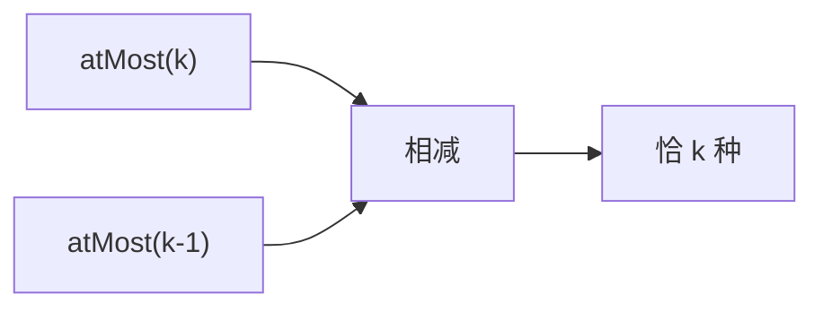

# LC 992. Subarrays with K Different Integers

> Hard · [LeetCode](https://leetcode.com/problems/subarrays-with-k-different-integers/) · Tags: Array, Hash Table, Sliding Window, Counting

## 题意

求恰含 `k` 种不同整数的子数组个数。

## 最优思路

滑动窗口：`atMost(k) - atMost(k-1)`，即「最多 k 种」减「最多 k-1 种」。

## 图解

## 复杂度

| 项 | 值 |
|----|----|
| 时间 | \(O(n)\) |
| 空间 | \(O(k)\) |

## 代码

见 `992.subarrays-with-k-different-integers.py`。
