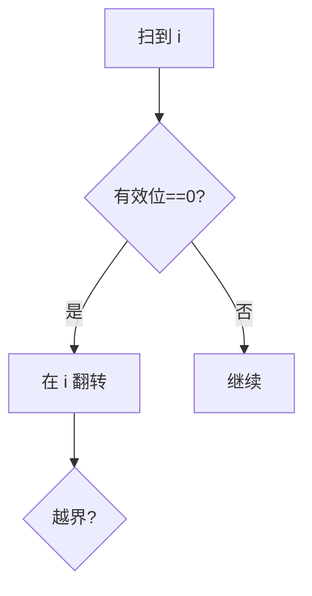

# LC 995. Minimum Number of K Consecutive Bit Flips

> Hard · [LeetCode](https://leetcode.com/problems/minimum-number-of-k-consecutive-bit-flips/) · Tags: Array, Bit Manipulation, Queue, Sliding Window, Prefix Sum, Brute-Force Search

## 题意

每次可翻转长度为 `k` 的连续位，求把数组全变成 1 的最少翻转次数；不可能返回 -1。

## 最优思路

贪心：从左到右，若当前位置有效值为 0 则必须在此开始翻转。用队列记录翻转起点，差分维护奇偶。

## 图解

## 复杂度

| 项 | 值 |
|----|----|
| 时间 | \(O(n)\) |
| 空间 | \(O(k)\) |

## 代码

见 `995.minimum-number-of-k-consecutive-bit-flips.py`。
