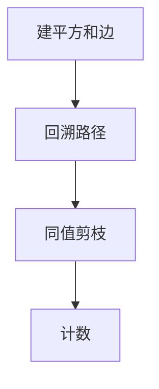

# LC 996. Number of Squareful Arrays

> Hard · [LeetCode](https://leetcode.com/problems/number-of-squareful-arrays/) · Tags: Array, Hash Table, Math, Dynamic Programming, Backtracking, Bit Manipulation, Bitmask

## 题意

求数组排列数，使得相邻两数之和均为完全平方数（相同排列只计一次）。

## 最优思路

建边：和为平方则连边；回溯枚举 Hamilton 路径，同值节点用下标序去重。

## 图解

## 复杂度

| 项 | 值 |
|----|----|
| 时间 | \(O(n! \\cdot n)\) |
| 空间 | \(O(n^2)\) |

## 代码

见 `996.number-of-squareful-arrays.py`。
