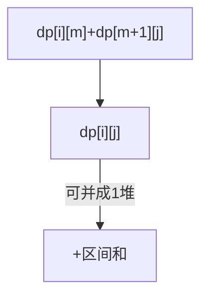

# LC 1000. Minimum Cost to Merge Stones

> Hard · [LeetCode](https://leetcode.com/problems/minimum-cost-to-merge-stones/) · Tags: Array, Dynamic Programming, Prefix Sum

## 题意

每次把连续 `K` 堆石子合成一堆，代价为这 K 堆之和；求合成一堆的最小代价，不可能返回 -1。

## 最优思路

区间 DP：仅当 `(n-1)%(K-1)==0` 可合并。`dp[i][j]` 合并区间到最少堆数；当堆数可并为 1 时加上区间和。

## 图解

## 复杂度

| 项 | 值 |
|----|----|
| 时间 | \(O(n^3/(K-1))\) |
| 空间 | \(O(n^2)\) |

## 代码

见 `1000.minimum-cost-to-merge-stones.py`。
