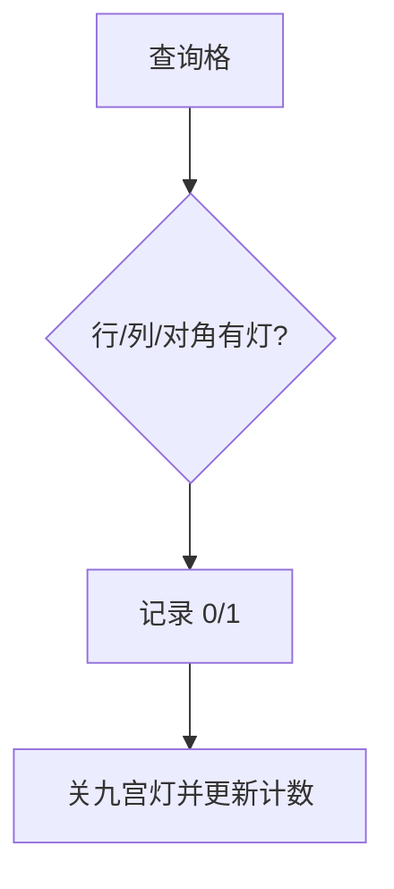

# LC 1001. Grid Illumination

> Hard · [LeetCode](https://leetcode.com/problems/grid-illumination/) · Tags: Array, Hash Table

## 题意

`n×n` 网格上灯照亮同行/列/对角线。每次查询格子是否被照亮，然后关掉该格及八邻域的灯。

## 最优思路

用哈希计数维护每行/列/两对角线上灯的数量；查询 O(1)，再关闭邻域灯并更新计数。

## 图解

## 复杂度

| 项 | 值 |
|----|----|
| 时间 | \(O(L+Q)\) |
| 空间 | \(O(L)\) |

## 代码

见 `1001.grid-illumination.py`。
