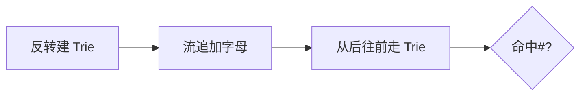

# LC 1032. Stream of Characters

> Hard · [LeetCode](https://leetcode.com/problems/stream-of-characters/) · Tags: Array, String, Design, Trie, Data Stream, Aho–Corasick Algorithm

## 题意

给定词典，对字符流逐字符查询：当前后缀是否为词典中某单词。

## 最优思路

把单词反转插入 Trie；每次 query 从流末尾向前匹配，遇到词尾标记即 True。

## 图解

## 复杂度

| 项 | 值 |
|----|----|
| 时间 | \(O(\\sum|w| + Q \\cdot L_{max})\) |
| 空间 | \(O(\\sum|w|)\) |

## 代码

见 `1032.stream-of-characters.py`。
