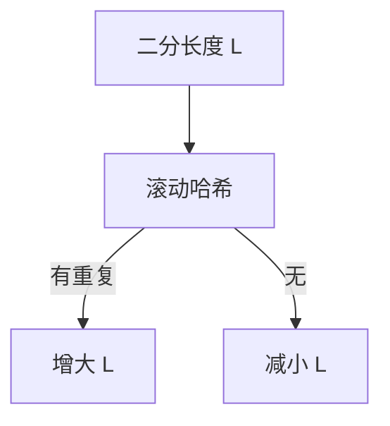

# LC 1044. Longest Duplicate Substring

> Hard · [LeetCode](https://leetcode.com/problems/longest-duplicate-substring/) · Tags: String, Binary Search, Sliding Window, Rolling Hash, Suffix Array, Hash Function, Suffix Automaton, Suffix Tree, Z Algorithm, Boyer–Moore String-Search Algorithm

## 题意

返回字符串中最长的重复子串（出现至少两次，可重叠）；无则空串。

## 最优思路

对长度二分 + Rabin-Karp 滚动哈希判重。哈希冲突概率极低（大模数）。

## 图解

## 复杂度

| 项 | 值 |
|----|----|
| 时间 | \(O(n \\log n)\) |
| 空间 | \(O(n)\) |

## 代码

见 `1044.longest-duplicate-substring.py`。
