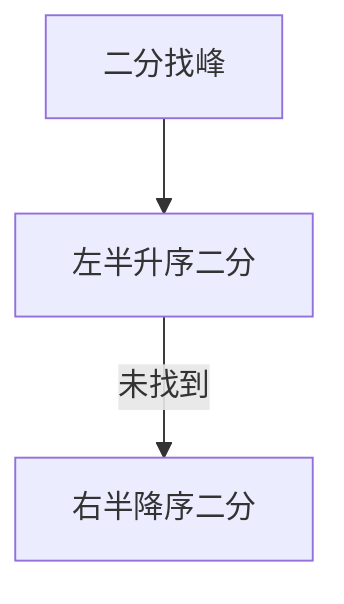

# LC 1095. Find in Mountain Array

> Hard · [LeetCode](https://leetcode.com/problems/find-in-mountain-array/) · Tags: Array, Binary Search, Interactive, Ternary Search

## 题意

山形数组（先严格增后严格减），通过 `MountainArray.get` 找 `target` 最小下标，调用次数受限。

## 最优思路

三次二分：先找峰顶，再在左升序段找，找不到再到右降序段找。

## 图解

## 复杂度

| 项 | 值 |
|----|----|
| 时间 | \(O(\\log n)\) |
| 空间 | \(O(1)\) |

## 代码

见 `1095.find-in-mountain-array.py`。
