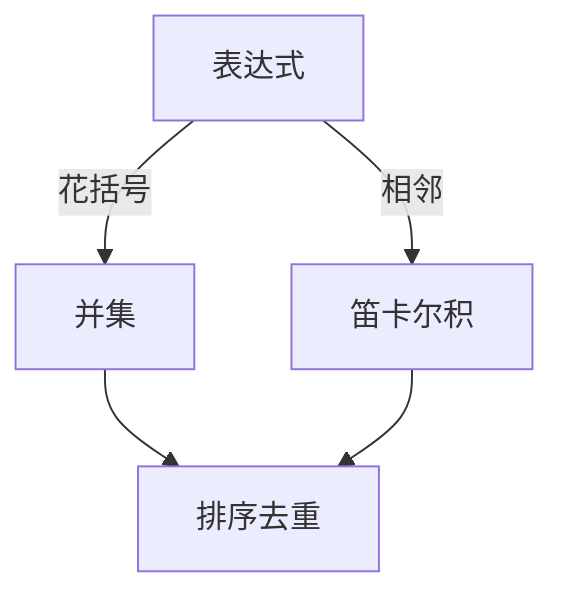

# LC 1096. Brace Expansion II

> Hard · [LeetCode](https://leetcode.com/problems/brace-expansion-ii/) · Tags: Hash Table, String, Backtracking, Stack, Breadth-First Search, Sorting

## 题意

解析花括号表达式：`,` 表示并集，相邻表示笛卡尔积拼接；返回排序去重结果。

## 最优思路

递归下降：遇到 `{` 递归求内层并集；字母串与当前集合做积；`,` 合并到并集并重置积。

## 图解

## 复杂度

| 项 | 值 |
|----|----|
| 时间 | \(O(R \\log R)\) |
| 空间 | \(O(R)\) |

## 代码

见 `1096.brace-expansion-ii.py`。
