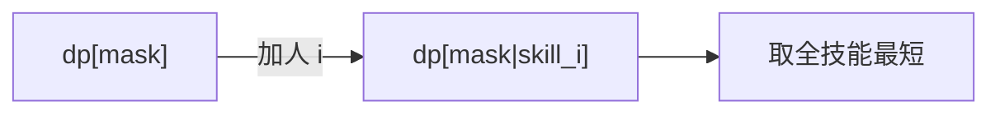

# LC 1125. Smallest Sufficient Team

> Hard · [LeetCode](https://leetcode.com/problems/smallest-sufficient-team/) · Tags: Array, Dynamic Programming, Bit Manipulation, Bitmask

## 题意

每人掌握若干技能，选最少人数覆盖全部 `req_skills`，返回人员下标列表。

## 最优思路

技能状压 DP：`dp[mask]` 为覆盖该技能集合的最短队伍；用每人技能掩码扩展转移。

## 图解

## 复杂度

| 项 | 值 |
|----|----|
| 时间 | \(O(n \\cdot 2^m)\) |
| 空间 | \(O(2^m \\cdot n)\) |

## 代码

见 `1125.smallest-sufficient-team.py`。
