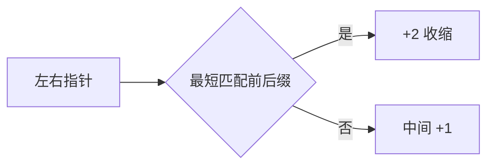

# LC 1147. Longest Chunked Palindrome Decomposition

> Hard · [LeetCode](https://leetcode.com/problems/longest-chunked-palindrome-decomposition/) · Tags: Two Pointers, String, Dynamic Programming, Greedy, Rolling Hash, Hash Function

## 题意

把字符串拆成尽量多段，使拼接后构成回文（段序列正读反读相同）。

## 最优思路

两端贪心：找最短前缀等于后缀则拆出两段，继续；中间剩一段则 +1。

## 图解

## 复杂度

| 项 | 值 |
|----|----|
| 时间 | \(O(n^2)\) |
| 空间 | \(O(1)\) |

## 代码

见 `1147.longest-chunked-palindrome-decomposition.py`。
