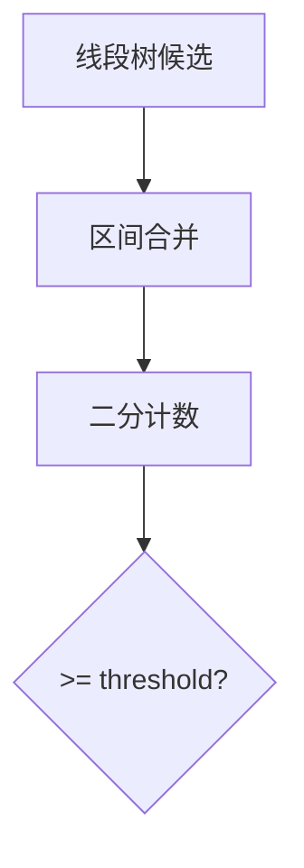

# LC 1157. Online Majority Element In Subarray

> Hard · [LeetCode](https://leetcode.com/problems/online-majority-element-in-subarray/) · Tags: Array, Binary Search, Design, Binary Indexed Tree, Segment Tree, Sqrt Decomposition, Boyer–Moore Majority Vote Algorithm

## 题意

设计数据结构：查询子数组 `[left,right]` 中出现次数 ≥ `threshold` 的众数候选（保证 threshold > 长度一半）。

## 最优思路

线段树存区间 Boyer-Moore 候选；查询得候选后用预建位置列表二分计数验证。

## 图解

## 复杂度

| 项 | 值 |
|----|----|
| 时间 | \(O(n \\log n + q \\log^2 n)\) |
| 空间 | \(O(n)\) |

## 代码

见 `1157.online-majority-element-in-subarray.py`。
