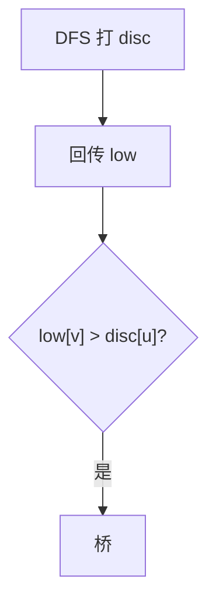

# LC 1192. Critical Connections in a Network

> Hard · [LeetCode](https://leetcode.com/problems/critical-connections-in-a-network/) · Tags: Depth-First Search, Graph Theory, Biconnected Component, Bridge (Graph)

## 题意

无向连通图中找所有桥（删掉后连通分量增加的边）。

## 最优思路

Tarjan：DFS 时间戳 `disc`/`low`，若子树 `low[v] > disc[u]` 则边 `(u,v)` 为桥。

## 图解

## 复杂度

| 项 | 值 |
|----|----|
| 时间 | \(O(n+e)\) |
| 空间 | \(O(n+e)\) |

## 代码

见 `1192.critical-connections-in-a-network.py`。
