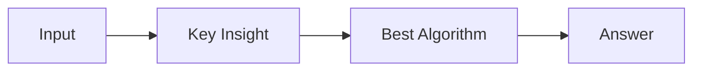

# LC 1250. Check If It Is a Good Array

> Hard · [LeetCode](https://leetcode.com/problems/check-if-it-is-a-good-array/) · Tags: Array, Math, Number Theory, Bézout's Lemma, Euclidean Algorithm, Greatest Common Divisor, Extended Euclidean Algorithm

## 题意

（待补：一句话题意）

## 最优思路

（待补：最优解核心 intuition）

## 图解

## 复杂度

| 项 | 值 |
|----|----|
| 时间 | TBD |
| 空间 | TBD |

## 代码

见同目录 `1250.check-if-it-is-a-good-array.py`。

## 参考

- https://leetcode.com/problems/check-if-it-is-a-good-array/
