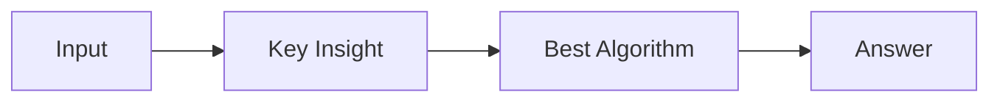

# LC 1284. Minimum Number of Flips to Convert Binary Matrix to Zero Matrix

> Hard · [LeetCode](https://leetcode.com/problems/minimum-number-of-flips-to-convert-binary-matrix-to-zero-matrix/) · Tags: Array, Hash Table, Bit Manipulation, Breadth-First Search, Matrix

## 题意

（待补：一句话题意）

## 最优思路

（待补：最优解核心 intuition）

## 图解

## 复杂度

| 项 | 值 |
|----|----|
| 时间 | TBD |
| 空间 | TBD |

## 代码

见同目录 `1284.minimum-number-of-flips-to-convert-binary-matrix-to-zero-matrix.py`。

## 参考

- https://leetcode.com/problems/minimum-number-of-flips-to-convert-binary-matrix-to-zero-matrix/
