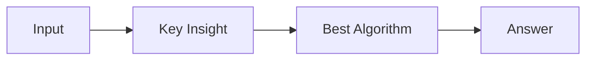

# LC 1316. Distinct Echo Substrings

> Hard · [LeetCode](https://leetcode.com/problems/distinct-echo-substrings/) · Tags: String, Trie, Rolling Hash, Suffix Array, Hash Function, Suffix Automaton, Suffix Tree

## 题意

（待补：一句话题意）

## 最优思路

（待补：最优解核心 intuition）

## 图解

## 复杂度

| 项 | 值 |
|----|----|
| 时间 | TBD |
| 空间 | TBD |

## 代码

见同目录 `1316.distinct-echo-substrings.py`。

## 参考

- https://leetcode.com/problems/distinct-echo-substrings/
