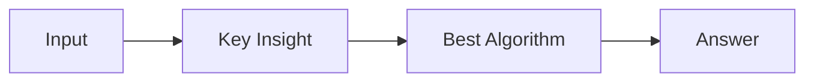

# LC 1467. Probability of a Two Boxes Having The Same Number of Distinct Balls

> Hard · [LeetCode](https://leetcode.com/problems/probability-of-a-two-boxes-having-the-same-number-of-distinct-balls/) · Tags: Array, Math, Dynamic Programming, Backtracking, Combinatorics, Probability and Statistics

## 题意

（待补：一句话题意）

## 最优思路

（待补：最优解核心 intuition）

## 图解

## 复杂度

| 项 | 值 |
|----|----|
| 时间 | TBD |
| 空间 | TBD |

## 代码

见同目录 `1467.probability-of-a-two-boxes-having-the-same-number-of-distinct-balls.py`。

## 参考

- https://leetcode.com/problems/probability-of-a-two-boxes-having-the-same-number-of-distinct-balls/
