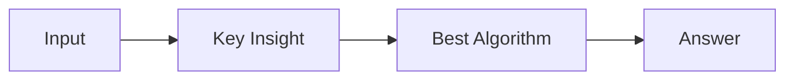

# LC 1483. Kth Ancestor of a Tree Node

> Hard · [LeetCode](https://leetcode.com/problems/kth-ancestor-of-a-tree-node/) · Tags: Binary Search, Dynamic Programming, Bit Manipulation, Tree, Depth-First Search, Breadth-First Search, Design, Binary Lifting

## 题意

（待补：一句话题意）

## 最优思路

（待补：最优解核心 intuition）

## 图解

## 复杂度

| 项 | 值 |
|----|----|
| 时间 | TBD |
| 空间 | TBD |

## 代码

见同目录 `1483.kth-ancestor-of-a-tree-node.py`。

## 参考

- https://leetcode.com/problems/kth-ancestor-of-a-tree-node/
