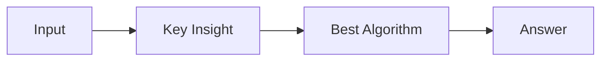

# LC 1510. Stone Game IV

> Hard · [LeetCode](https://leetcode.com/problems/stone-game-iv/) · Tags: Math, Dynamic Programming, Minimax, Game Theory, Nim Game, Sprague–Grundy Theorem, Zero-Sum Game

## 题意

（待补：一句话题意）

## 最优思路

（待补：最优解核心 intuition）

## 图解

## 复杂度

| 项 | 值 |
|----|----|
| 时间 | TBD |
| 空间 | TBD |

## 代码

见同目录 `1510.stone-game-iv.py`。

## 参考

- https://leetcode.com/problems/stone-game-iv/
