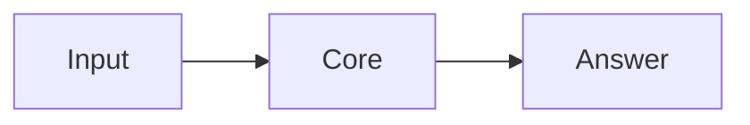

# LC 1516. Move Sub-Tree of N-Ary Tree

> Hard · [LeetCode](https://leetcode.com/problems/move-sub-tree-of-n-ary-tree/)

## 题意

把 p 子树移到 q 下，处理祖先环。

## 最优思路

建父指针；分类重接。

## 图解

## 复杂度

| 项 | 值 |
|----|----|
| 时间 | O(n) |
| 空间 | O(n) |
